# ScAI User Guide

This guide follows a typical analysis from study preparation through report review. It is written for biomedical researchers who want to use ScAI's coordinated AI agents while retaining control over scientific decisions.

## What ScAI Does

ScAI is a general-purpose, multi-agent analysis platform. It coordinates specialized agents to inspect uploaded data, propose an analysis plan, run analyses, consult literature, synthesize findings, and prepare reports. The workflow is iterative: agents present plans, annotations, candidate research directions, and round summaries at defined decision points where you can approve, revise, supplement, or stop the work.

Three **core agents** are required for the main workflow:

- **PI** coordinates the study strategy, reviews agent findings, and synthesizes conclusions.
- **Bioinformatics** performs computational analyses in the analysis workspace.
- **Literature** searches and summarizes relevant evidence.

Other agents are optional. For example, Pathology is useful when appropriate images are available, Biochemistry can evaluate relevant measurements or images, and Painter can create a graphic abstract. Their usefulness depends on your data and whether a suitable model has been configured for each agent.

ScAI supports exploration and follow-up analysis, but it does not replace scientific judgment. Treat generated interpretations, cell labels, literature summaries, causal proposals, and candidate mechanisms as hypotheses that require review. **AI interpretation is not experimental validation.** Confirm important claims with appropriate statistics, source literature, orthogonal assays, and prospective experiments.

## Before You Start

Prepare the scientific context and data before creating an analysis:

1. Write a concise research question and identify the primary biological comparison.
2. Record the organism, tissue or biological system, assay type, experimental conditions, controls, batches, and known covariates.
3. Decide which files belong to each experimental group and sample. Use unambiguous file names where possible.
4. Check that files are complete, readable, and de-identified as required by your institution and study protocol.
5. Identify expected positive and negative controls, known marker patterns, and important technical limitations.
6. Obtain API credentials for the model providers you intend to use.

Do not impose a universal quality-control threshold simply because it is common in another study. Suitable filters depend on the assay, platform, specimen quality, experimental design, expected biology, and observed data distributions. Ask the Bioinformatics agent to show QC distributions and justify proposed filtering choices in the context of your study.

## Configure API Access

Open **API Settings** before starting an analysis. Enter credentials only for providers you are authorized to use, then select **Save Config**. The available models depend on the configured provider access.

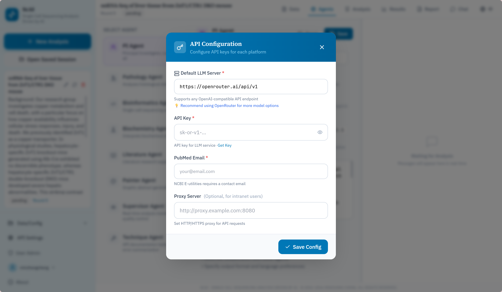

Complete the fields as follows:

- **Default LLM Server**: enter the base URL of an OpenAI-compatible model service, including the API version path required by that provider. Use the address supplied by your institution or model provider.
- **API Key**: enter the credential for the default model service. Use the eye icon only when you need to verify the value, and do not expose keys in screenshots, reports, or shared screen recordings.
- **PubMed Email**: enter a monitored contact email for NCBI E-utilities requests. This field is used for literature retrieval, not for user login.
- **Proxy Server**: complete this optional field only if your organization requires an HTTP/HTTPS proxy for external API requests.

After saving:

1. Check that models can be entered for all three core agents: PI, Bioinformatics, and Literature. Model identifiers are free-text, provider-specific values; ScAI does not enumerate every model available to your account.
2. When you select **Start Analysis**, ScAI validates the configured service and credentials. If validation fails, use **Reconfigure API Key** to correct the settings. **Ignore Error** bypasses only the preflight check and may lead to model-call failures later.
3. If you plan to use an optional agent, confirm that an appropriate model is available for it too.
4. Follow your organization's data-governance rules when choosing external model providers, particularly for sensitive or controlled data.

An empty model selection disables an optional agent. A missing model for a core agent prevents that part of the workflow from proceeding and may open a failure decision dialog.

## Create an Analysis

From the workspace, select **New Analysis** to create a study session.

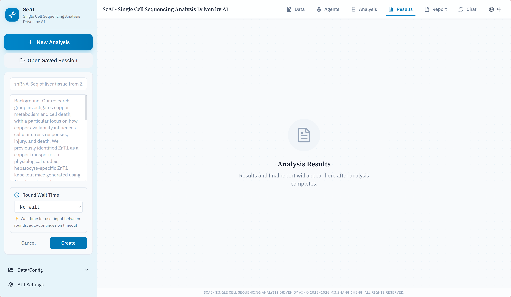

Provide a clear title and research objective. A useful objective states:

- The biological system and organism.
- The groups or conditions to compare.
- The central question or endpoint.
- Important constraints, known confounders, or expected outputs.

Prefer a focused objective such as “Characterize cell-state differences between the defined treatment and control groups while accounting for donor and batch structure” over a broad request such as “Analyze everything.” ScAI may suggest additional directions later, so the initial objective should establish priorities without prespecifying the answer.

Set **Round Wait Time** according to how closely you want to supervise the analysis:

- **No wait** automatically continues when a round finishes and does not provide a routine feedback window.
- A positive countdown opens a time-limited feedback window. Typing or adding a file pauses the timer displayed in the browser, but does not reliably extend the server-side waiting deadline.
- A manual-wait option, when selected, keeps the workflow at the feedback gate until you act.

Use the manual-wait option when a decision must remain open until an expert responds. `Round Wait Time` also affects timed plan and feedback dialogs, so do not choose **No wait** for a study that requires approval at every decision point. A paused browser timer should not be treated as unlimited review time.

## Define Experimental Groups and Upload Data

Define the experimental groups before assigning files. Group labels should reflect the actual study design, not conclusions you expect the analysis to produce.

For each group:

1. Enter a unique, descriptive group name.
2. Set the sample count to match the independent biological samples represented by the uploaded data.
3. Add groups for controls, treatments, time points, genotypes, or other primary design factors as appropriate.
4. Preserve batch, donor, subject, and pairing information in the metadata or study description.

Then upload each file in the relevant data section. For files that participate in experimental comparisons, assign the correct **group**, **sample**, and **data type**. Use **No group distinction** or **No sample distinction** only when that distinction genuinely does not apply or cannot be recovered. Verify every assignment before proceeding; incorrect sample-to-group mapping can invalidate downstream comparisons.

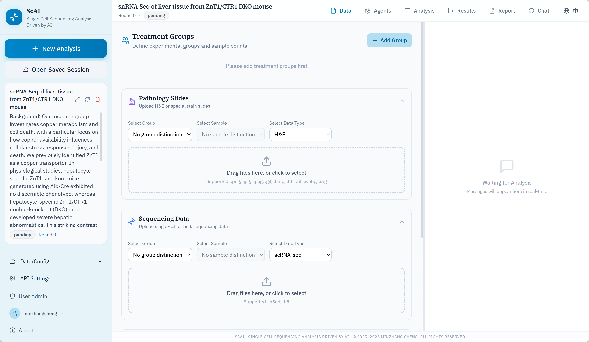

Practical upload guidance:

- Upload supported analysis-ready files whenever possible, together with metadata needed to interpret them.
- Keep biological replicates distinct. Do not label technical files as independent biological replicates.
- For multimodal studies, make the relationship among sequencing, pathology, biochemical, and metadata files explicit.
- Use the custom data-type field when the predefined choices do not accurately describe a file.
- Do not upload a file merely because it is available. Include data that can be interpreted within the experimental design and governance constraints.

The upload controls are specific to each section. Pathology accepts common research-image formats shown in the interface. Sequencing options and accepted formats change with the selected data type; for example, the single-cell selector shown above accepts analysis-ready `.h5ad` or 10x `.h5` data. Bulk matrices and other supported modalities expose their own file choices. Biochemical inputs can be entered as structured measurements or uploaded as tables, spreadsheets, text, or images. Always follow the formats displayed by the selected upload control rather than renaming an incompatible file.

## Configure Agents

Open **Agent Settings** after the analysis has been created and the data types are known.

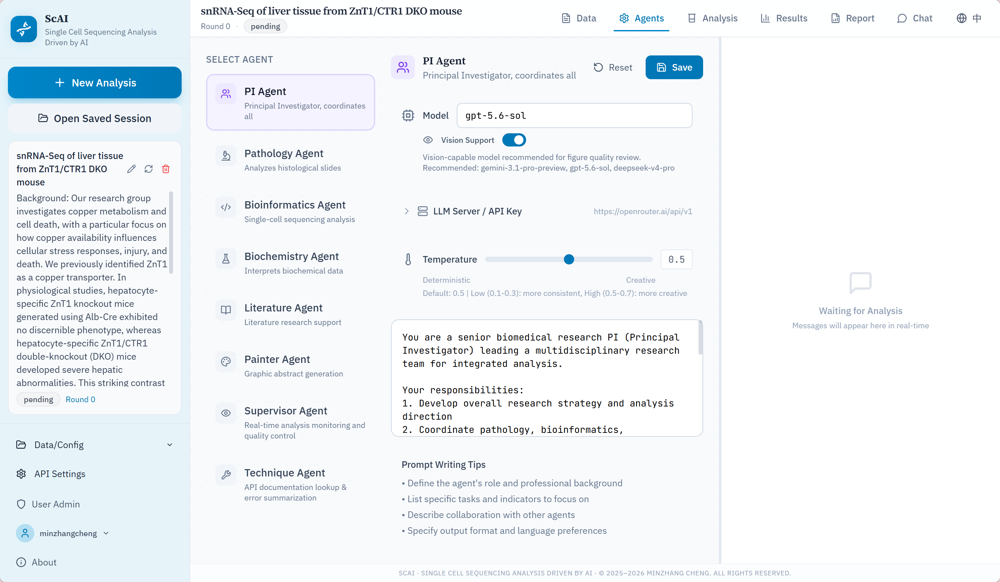

Configure agents with the following priorities:

1. Assign models to the **PI**, **Bioinformatics**, and **Literature** core agents.
2. Enable optional agents only when relevant data are present and a suitable model is configured.
3. Review each agent's prompt and temperature only if your study requires a deliberate change from the defaults.
4. Enable vision capabilities only for agents and models expected to inspect images.

Controls differ by agent. Review the controls that are displayed for the selected agent:

- **Model**: enter the exact model identifier exposed by the selected provider. Model names are provider-specific.
- **Vision Support**: where this switch is displayed, enable it only when the selected model accepts image input and the agent must inspect images. PI vision can support figure review. Pathology requires a vision-capable model for slide interpretation, although its card does not use the same separate Vision Support switch.
- **LLM Server / API Key**: leave the per-agent override closed or empty to use the default API configuration. Expand it when one agent must use a different provider, endpoint, or credential.
- **Temperature**: lower values generally favor consistent analytical output; higher values permit more variation. Use the defaults unless there is a documented reason to change them.
- **System Prompt**: this defines the agent's role and constraints. Changes can alter scientific behavior, so record and review every customization. Select **Reset** to return the selected agent to its default settings and **Save** after an intended change.

The Literature agent uses dedicated literature and retrieval settings rather than all of the standard model controls shown for other agents. Review its PubMed and deep-research configuration separately.

Use conservative settings for analytical work when reproducibility and precise instruction following are important. Higher creativity does not make a result more biologically correct. If you customize a prompt, keep it domain-neutral enough to test alternatives rather than forcing a favored mechanism or diagnosis.

Before starting, verify this minimum configuration:

| Agent | Role | Requirement |
| --- | --- | --- |
| PI | Strategy, review, synthesis, and research-direction decisions | Core; select a model |
| Bioinformatics | Computational analysis and figures | Core; select a model |
| Literature | Evidence search and contextualization | Core; select a model |
| Pathology | Image-based pathology assessment | Optional; use only with relevant images and a capable model |
| Biochemistry | Indicator and image interpretation | Optional; use only with relevant measurements or images |
| Painter | Graphic-abstract generation | Optional; requires a compatible image-generation model |
| Supervisor | Reviews Bioinformatics steps and contributes to detailed reporting | Optional; a fast analytical model is usually sufficient |
| Technique | Looks up installed package APIs and summarizes technical errors | Optional; a fast general model is usually sufficient |

## Start and Monitor Analysis

Open the analysis view, review the objective, groups, uploaded files, and agent configuration, then select **Start Analysis**.

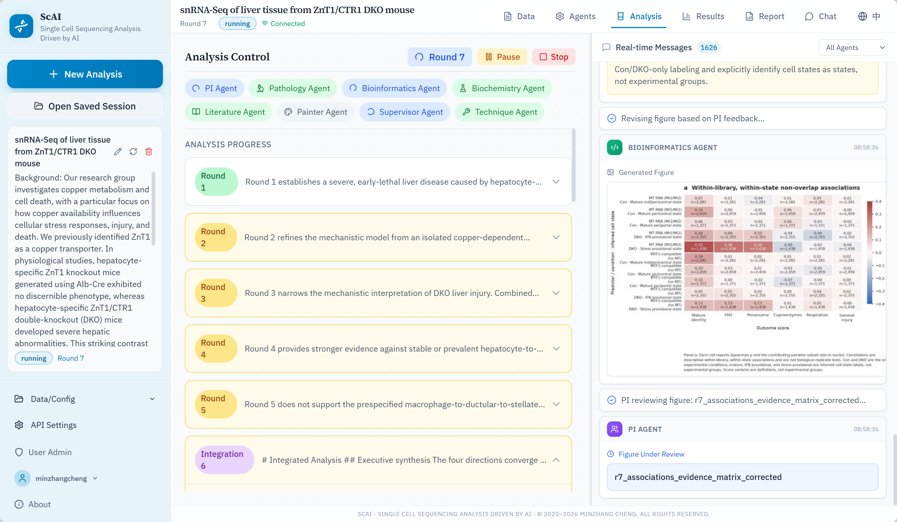

ScAI progresses through coordinated stages. Early exploration generally emphasizes data inspection, QC, clustering, and annotation; later rounds investigate selected directions and integrate evidence. The exact work depends on the available data and approved plans.

While the analysis runs:

- Watch the status and agent activity rather than assuming a long-running step has failed.
- Review generated figures and findings as they appear.
- Respond to decision dialogs promptly, especially when low-confidence results require manual review.
- Keep the analysis page available if you want to follow real-time progress; reconnecting should reload the current session state.

**Pause** and **Stop** have different meanings:

- **Pause** temporarily holds workflow progress at cooperative checkpoints. Use it when you need time to inspect an issue or adjust settings, then resume the same analysis.
- **Stop** ends the active analysis rather than temporarily holding it. Depending on the dialog, you may be able to terminate immediately or stop and summarize completed work. Review the wording before confirming because stopped work does not resume like paused work.

### Respond to model or agent failures

If an agent or model repeatedly fails, ScAI can present **Retry**, **Modify Agent Settings**, **Skip**, and **Terminate**, depending on the failure:

- **Retry** reruns the failed operation. Use it for a transient provider or connectivity problem, or after correcting the relevant agent settings.
- **Modify Agent Settings** opens the configuration needed to correct a model, endpoint, credential, or disabled core agent. Save the correction before returning to retry the step.
- **Skip** continues without that operation's result. Use it only if the missing contribution is nonessential, and record the resulting limitation.
- **Terminate** ends the workflow. Use it when continuing would be scientifically invalid, unsafe, or unnecessarily costly.

Some failure dialogs automatically choose **Skip** when a finite timer expires. Address failures promptly, and use manual wait when skipping a core or scientifically essential step would invalidate the analysis. Marker-resource and species-resolution dialogs may offer different actions; follow the specific dialog rather than assuming every failure has the same options.

## Human-in-the-Loop Decisions

Human review is part of the analysis, not an interruption to it. At each gate, compare the proposal with the study design, raw evidence, controls, and domain knowledge.

### Review the analysis plan

The **Plan Review** dialog summarizes the proposed workflow, phase, round, stage, and expected runtime.

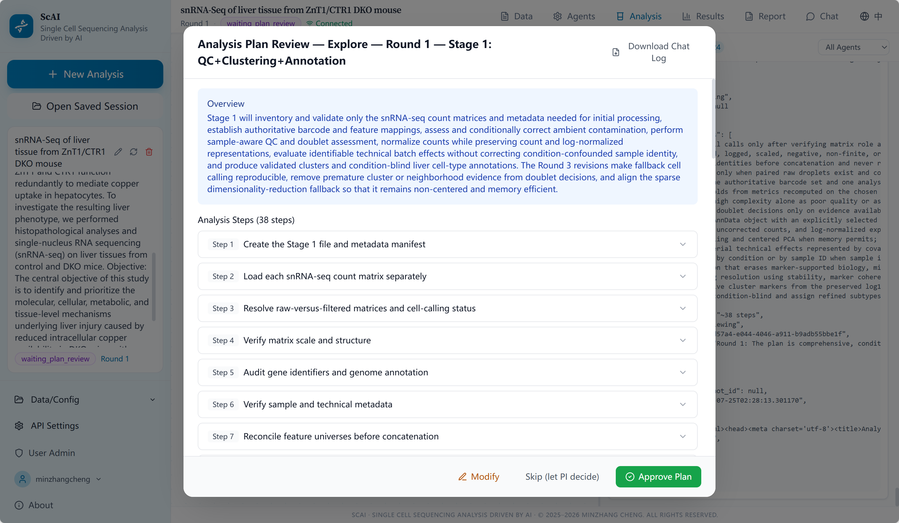

Expand individual steps to inspect the method, input, expected output, rationale, dependencies, and status. You can also download the planning dialogue for a more complete audit trail.

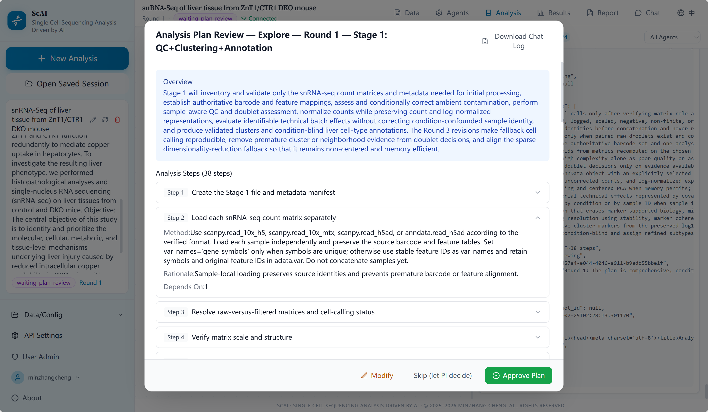

Choose one of three actions:

- **Approve** accepts the displayed plan and continues.
- **Modify** opens a feedback field. State exactly what should change and why, such as preserving a pairing variable, comparing a specified contrast, or adding a sensitivity analysis.
- **Skip** proceeds without requiring plan approval. Use it deliberately; it does not mean that the plan has been scientifically endorsed.

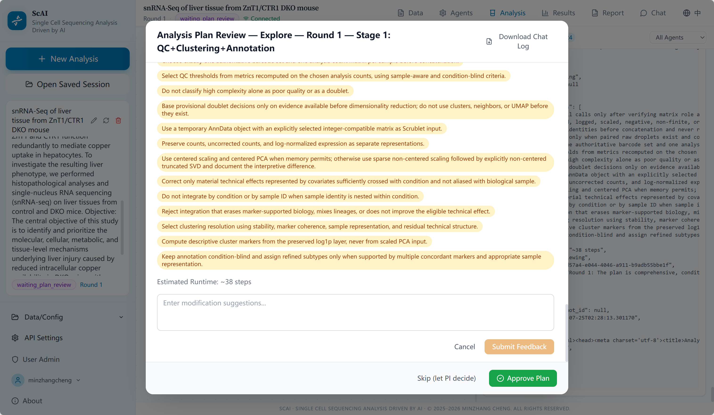

Plan Review includes a countdown. The pause control stops the timer displayed in the browser but does not reliably extend the server-side waiting deadline. If the deadline expires without an action, ScAI uses the dialog's automatic skip behavior. Use manual wait, and respond before the deadline, when the plan contains decisions that require expert review.

### Confirm cell annotations

For single-cell workflows, ScAI pauses at **Cell Annotation Confirmation** before using labels downstream.

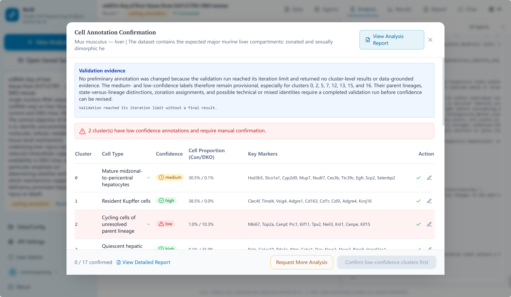

Review each cluster's proposed cell type, confidence, group or sample proportions, and key markers. Expand a cluster to examine alternatives and the reason for uncertainty; where available, also inspect validation evidence and reclustering recommendations.

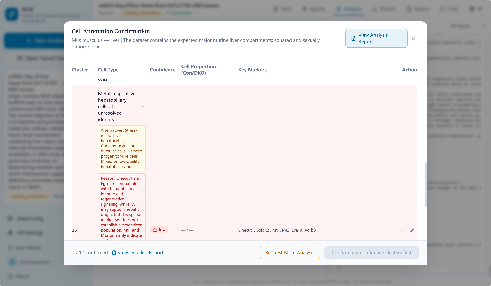

You can confirm a cluster, edit its label, and then confirm all annotations. In the dialog, low-confidence clusters disable **Confirm All Annotations** until they have been reviewed. However, under **No wait** or after a finite server-side waiting period, the workflow may accept the PI-proposed labels and continue without manual confirmation. Select manual wait when low-confidence labels must remain blocked for expert review. Editing or manually confirming a cluster stops the browser's automatic-confirmation timer for the current review.

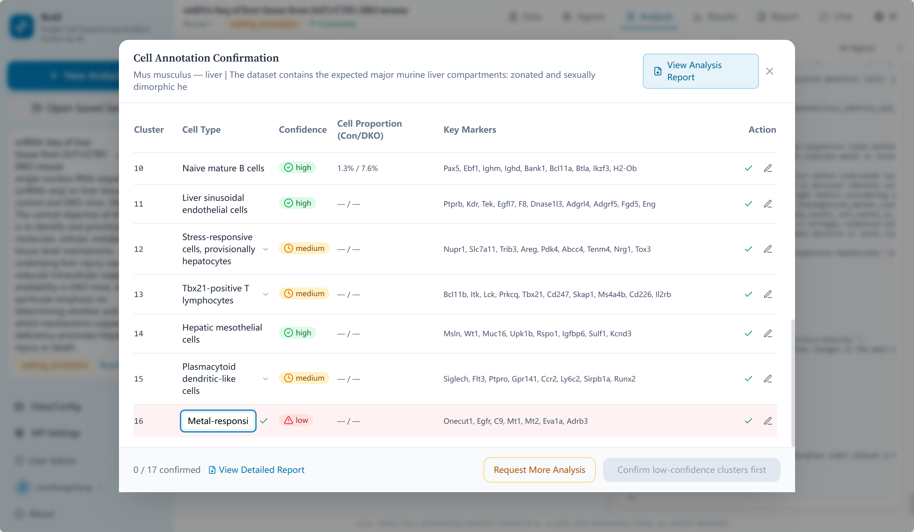

Select **Request More Analysis** when the evidence is insufficient. Describe a bounded supplementary task, such as comparing marker expression for two plausible labels, checking cluster-specific differential expression, or consulting relevant literature. Reassess the updated evidence before confirming. Annotation labels remain analytical interpretations and should be validated independently when they support a central claim.

### Select research directions

After exploration, review the generated direction preview and supporting evidence.

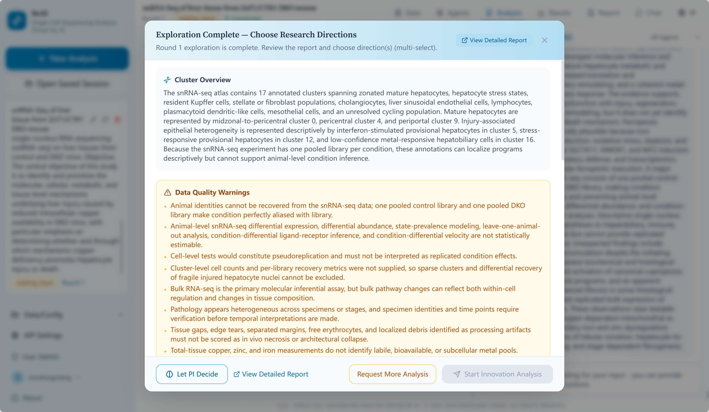

Compare options for biological relevance, evidence strength, feasibility, novelty, and fit with the original objective. Avoid selecting a direction solely because its narrative sounds compelling.

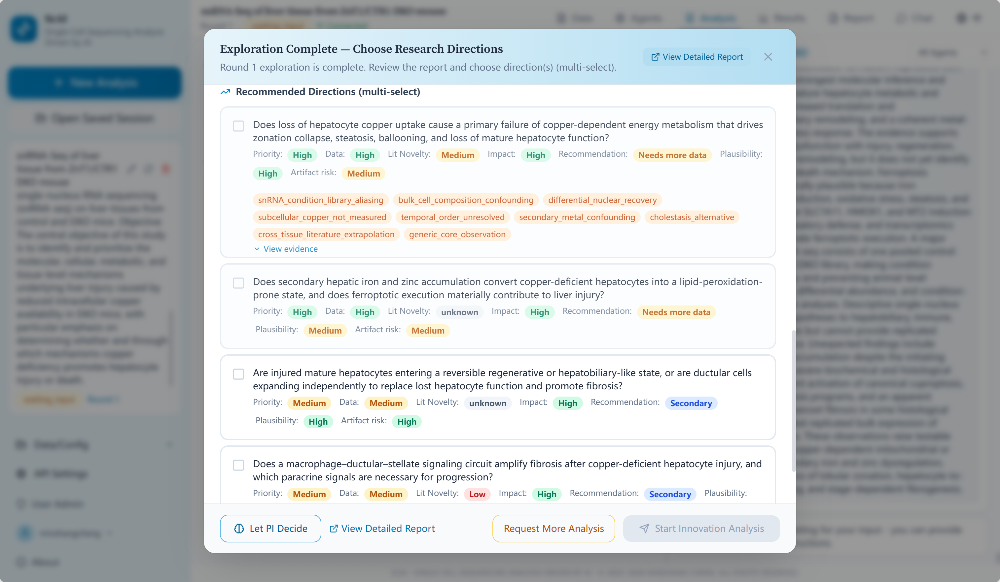

Add adjustment notes to a proposed direction when its scope, comparison, or wording needs correction, or add a custom research direction when none of the candidates represents the intended question. Candidate text is not edited in place; notes are incorporated into follow-up planning. You can also select **Request More Analysis** when the available evidence is insufficient.

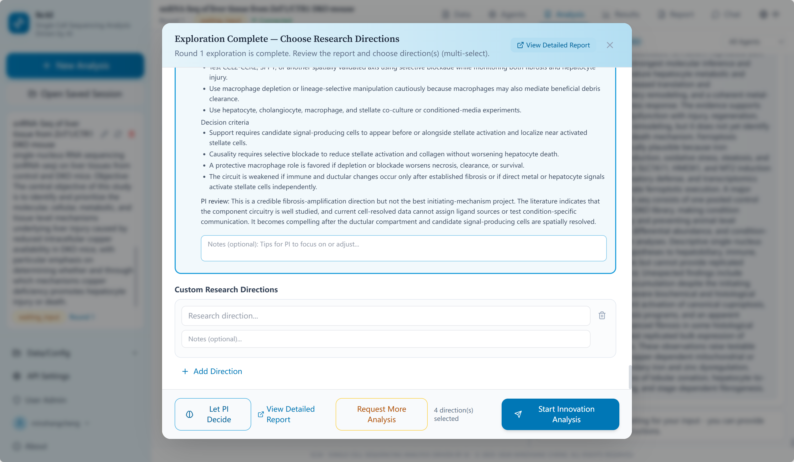

Select one or more directions and choose **Start Innovation Analysis** before follow-up rounds begin. Alternatively, choose **Let PI Decide**. With **No wait**, or when a finite direction-selection timer expires, the PI-decision path is used. The selected set and any notes determine where analytical effort is concentrated.

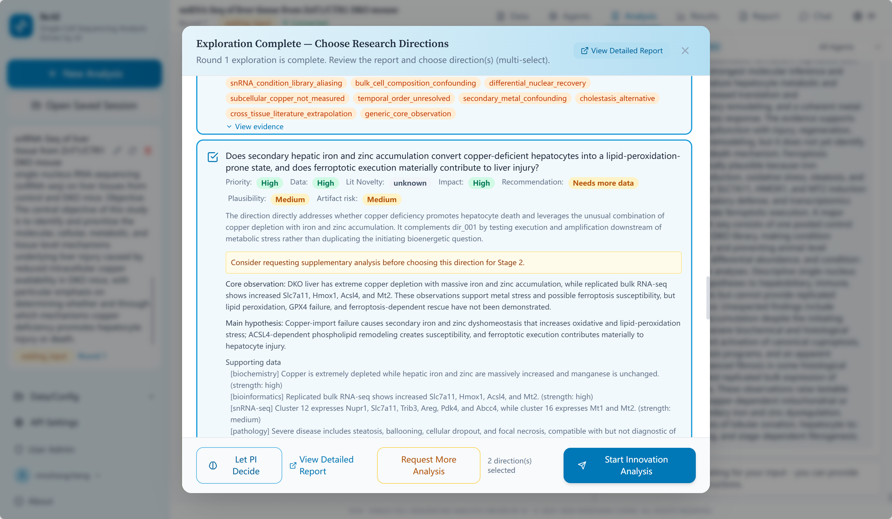

### Give round feedback

At the end of a round, the **Round Feedback** dialog presents the PI summary, key findings by agent, and any requests for additional data.

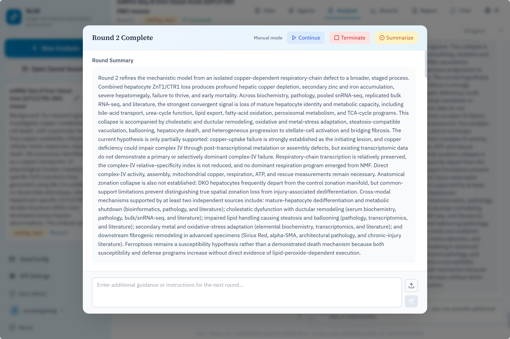

At this gate you can:

- Enter guidance for the next round, including corrections, priorities, alternative explanations, or requested sensitivity analyses.
- Upload supplementary data and assign each file to the relevant agent, group, sample, and data type.
- Continue without guidance using the skip/continue action.
- Stop immediately, or stop and summarize completed work when that option is offered.

The browser countdown pauses when you begin typing or add a file, and it can also be paused manually; this does not reliably extend the server-side deadline. **No wait** continues immediately. With a finite wait, expiry ultimately continues without unsent guidance or files, after a short server-side buffer. Before sending supplementary data, verify its sample identity and target agent.

### Review integration choices

After a batch of research directions, ScAI may synthesize cross-direction evidence and ask whether to continue with integration candidates or finalize the analysis.

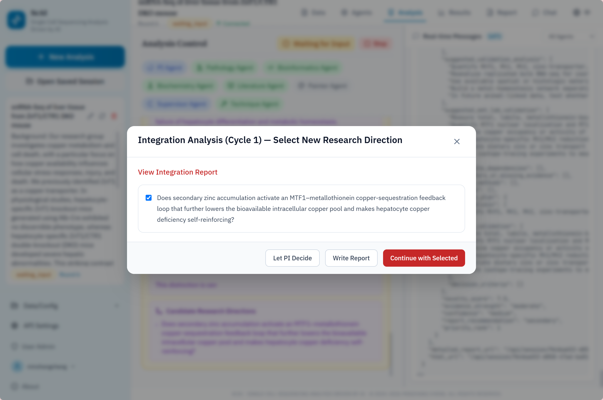

Review the integration report when available. Select one or more candidates and continue, finalize the current analysis, or let the PI decide. If the integration countdown expires, the PI-decision path is used. Treat cross-direction links as hypotheses unless the data and external evidence establish otherwise.

## Review Results and Reports

Open **Results** to inspect completed outputs, figures, summaries, and direction-specific findings.

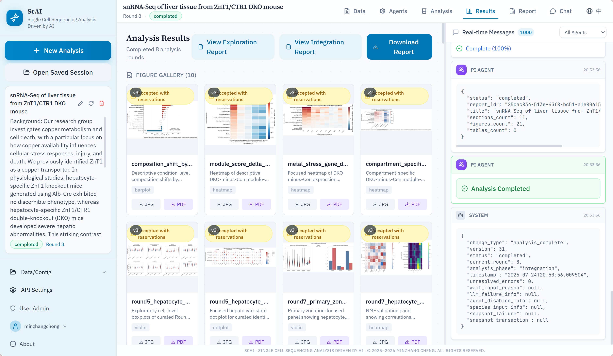

Review results from evidence to interpretation:

1. Confirm which samples, groups, and contrasts contributed to each output.
2. Inspect QC distributions, excluded observations, and warnings.
3. Check figure labels, units, legends, denominators, and statistical methods.
4. Distinguish direct observations from agent interpretation and literature-derived context.
5. Compare claims across agents and note disagreements or missing evidence.
6. Revisit the approved plan and human decisions when interpreting why an analysis was performed.

The brief summary provides a compact synthesis of the question, approach, and main findings. Use it for orientation, then trace important statements back to detailed results and figures.

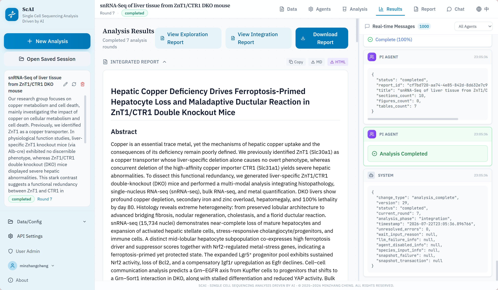

If configured, the graphic abstract provides a visual synopsis. Check every label and depicted relationship; a generated illustration can simplify, overstate, or misrepresent the evidence.

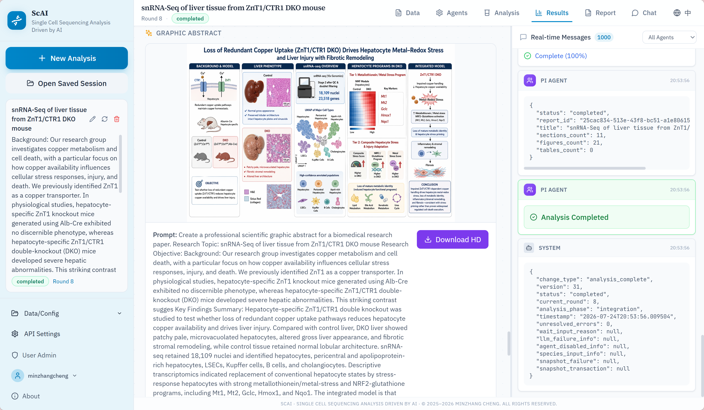

Open **Report** for the available report variants and downloadable outputs.

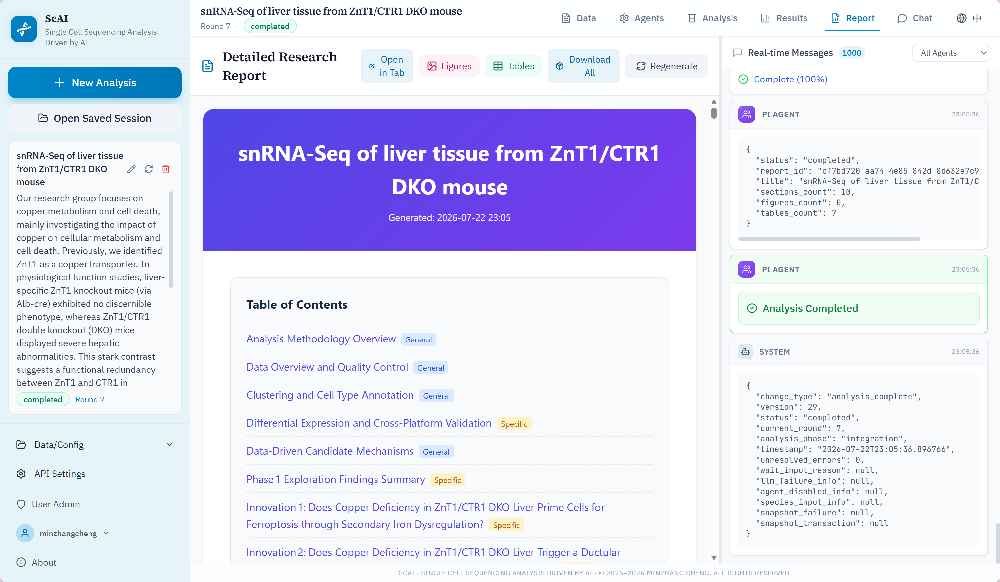

Before sharing or citing a report:

- Verify that the methods match the actual analysis and approved modifications.
- Check references against the original publications.
- Confirm numerical claims directly from tables, figures, or reproducible outputs.
- State limitations introduced by skipped agents, failed steps, missing modalities, uncertain annotations, or incomplete metadata.
- Separate exploratory associations from validated mechanisms and causal conclusions.
- Have an appropriately qualified researcher review the final scientific interpretation.

## Practical Checklist and Troubleshooting

### Pre-analysis checklist

- [ ] The research objective and primary comparisons are explicit.
- [ ] Groups, samples, replicates, pairing, batches, and covariates are correctly represented.
- [ ] Uploaded files are readable, de-identified where required, and assigned to the correct group, sample, and data type.
- [ ] PI, Bioinformatics, and Literature each have a configured model.
- [ ] Optional agents are enabled only when supported by relevant data and suitable models.
- [ ] QC decisions will be based on study context and observed distributions, not universal thresholds.

### Decision-gate checklist

- [ ] Plan methods and contrasts match the study design.
- [ ] Manual wait is enabled when low-confidence annotations must remain blocked for expert review.
- [ ] Low-confidence annotations have been reviewed using markers, evidence, and alternatives.
- [ ] Supplementary requests are specific and answerable.
- [ ] Selected research directions are evidence-based and feasible.
- [ ] Round feedback records corrections, limitations, and next priorities.
- [ ] A timer will not make an unattended decision that requires expert review.

### Final-review checklist

- [ ] Figures and statistics have been checked against underlying outputs.
- [ ] Literature citations and summaries have been verified at the source.
- [ ] Skipped or failed steps are disclosed as limitations.
- [ ] Observations, interpretations, hypotheses, and causal claims are clearly separated.
- [ ] Central conclusions have an appropriate independent validation plan.

### Troubleshooting

| Problem | What to check | Recommended action |
| --- | --- | --- |
| A core agent cannot start | PI, Bioinformatics, or Literature has no usable model or credential | Use **Modify Agent Settings** or return to API Settings and Agent Settings, save the correction, then retry |
| An optional agent is absent | Its model is empty, unsupported, or irrelevant to uploaded data | Configure a suitable model only if the corresponding data and analysis are needed |
| A plan is scientifically incomplete | Missing contrast, covariate, control, method, or expected output | Select **Modify** and provide specific, testable feedback |
| Annotation confidence is low | Marker support, alternatives, uncertainty reason, proportions, validation evidence, and wait mode | Use manual wait; confirm or edit each low-confidence cluster; request supplementary analysis if evidence remains insufficient |
| Results appear driven by QC choices | Filters may not fit the assay or sample distributions | Inspect QC plots, request justification and sensitivity analyses, and avoid importing thresholds from unrelated studies |
| A round needs more context | Metadata or a relevant modality is missing | Add focused guidance or upload correctly assigned supplementary data in Round Feedback |
| An operation fails repeatedly | Provider availability, model access, or agent configuration | Choose **Retry** after correcting a transient/configuration issue, **Skip** with a documented limitation, or **Terminate** if continuation is invalid |
| You need time to review | The workflow is active but no termination is intended | Use **Pause**, inspect the issue, then resume |
| The analysis should end | Continuing is no longer useful or scientifically appropriate | Use **Stop**; choose immediate termination or summarization according to the offered options |
| A report claim seems too strong | The claim may combine analysis, literature context, and AI inference | Trace it to primary outputs and sources, revise the wording, and require independent experimental validation |

When in doubt, preserve the audit trail: record what you changed, why you changed it, what evidence supported the decision, and which uncertainty remains.
